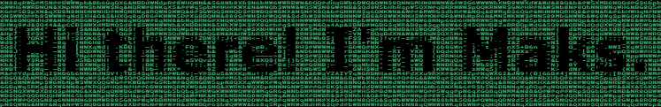

  

  <h3>Frontend Developer · React, TypeScript · Astana, Kazakhstan</h3>

  

    I build web apps with React and TypeScript and Telegram bots on Node.js. 
    Background in robotics: microcontrollers, soldering, firmware.
  

  

    <a href="https://czenturion.github.io/cv/">Website</a> ·
    <a href="https://t.me/czenturion">Telegram</a> ·
    <a href="mailto:czenturijon@gmail.com">Email</a> ·
    <a href="https://www.linkedin.com/in/czenturion/">LinkedIn</a>
  

  <h3>Tech stack</h3>

  

  
Also: Zustand, RTK Query, React Hook Form, Zod, shadcn/ui, Radix, Storybook, Jest, Playwright, Telegraf

   

  

